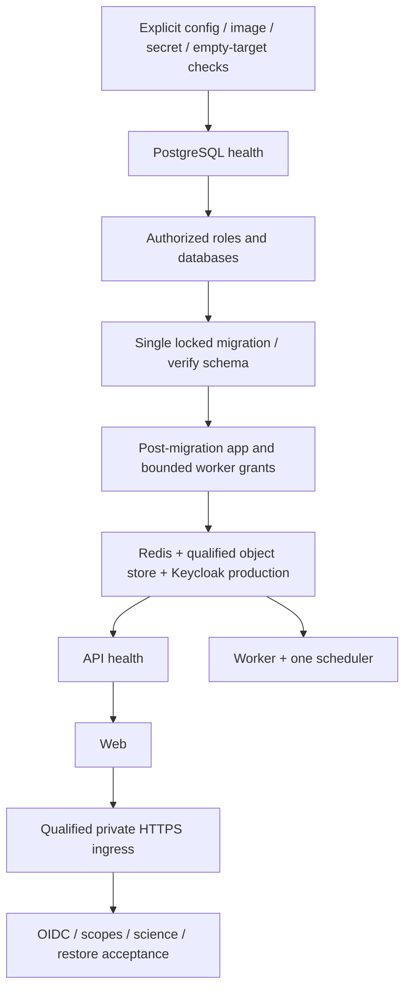

# DEPLOY-01 — Reproducible deployment foundation

Status: foundation for review, **not a deployable/qualified release**. PR16 merged at
`ab0ec42144dbc34629b2675cc67b4364d5abc820`; no Mac mini contacted.

## Execution plan and boundaries

Spec: user DEPLOY-01 request and PILOT_HOSTING_PLAN.md. Implementation stays on
`codex/deploy-01-reproducible-foundation`. No scientific/frontend logic change.
Use inline execution with isolated, explicitly named disposable test resources.

- [x] A/B: inventory and storage evidence; decision remains blocked (ADR-0007).
- [x] C/F: independent definition and static refusals; runtime not approved.
- [x] D: local OCI build/export contract and ARM64 artifacts; registry/AMD64 OCI
  and native cross-architecture release qualification remain open.
- [x] E/G: disposable bootstrap/migration, restart/resume and storage tests.
- [ ] H: final review delivery/CI recorded in the PR; full pilot gates still open.

Storage substitution is not authorized implicitly. An unavailable/unmaintained
artifact leaves the storage gate blocked; this must not produce a ready release.
No production digests, secrets, names or security acceptance will be invented.

## A. Inventory and corrective evidence

This is the DEPLOY-01 inventory, not a repeated whole-product audit. No existing
dev definition, application logic, Alembic revision or scientific engine changed.

| Existing item | State and risk | Foundation / verification |
|---|---|---|
| API Dockerfile | Micromamba 2.4.0; envs/api.yml exact direct Python versions, transitive resolution not fully locked; non-root runtime | SHA Git archive build, OCI digest, provenance and SBOM; no claim of byte-for-byte rebuild or complete transitive lock |
| Web Dockerfile | Node 22.23.0 Alpine3.23, npm lock, non-root Next standalone; mutable base tag | Same archive/digest/metadata path; build passes, no production source bind |
| Worker Dockerfile | Micromamba 2.4.0, Primer3 2.6.1 SHA256 source, BLAST 2.17.0 ARCH switch/checksums; non-root | Same image for worker/scheduler; real golden Primer3 tests; transitive/base/scanner pinning remains supply-chain hardening |
| PostgreSQL | postgres:17.11-alpine, shared dev superuser, application and Keycloak DB; seed on dev startup | Required image digest, separate roles/databases; disposable role/bootstrap/migration tests; no demo seed |
| Redis/Celery | redis:7.4.10-alpine, persistent AOF; Celery5.4.0 worker and Beat, UUID/claim token payload | Required digest/auth parameters, private network, same worker/scheduler digest; existing recovery mechanisms preserved |
| Keycloak | quay.io/keycloak/keycloak:26.7.2, dev start/import and demo realm | Required digest, production `start`, external read-only config, independent DB credential, no demo import; real OIDC/MFA unverified |
| MinIO | historical tag, cached ARM64 artifact, unresolved retrievability/maintenance | Required explicit MINIO_IMAGE digest, no substitution; ADR-0007 proposed, isolated SDK/restart/logical restore test |
| Proxy | caddy:2.11.4-alpine, dev unqualified HTTP port, dev Caddyfile | Required digest and external qualified HTTPS Caddyfile; private/loopback binding, only443 published; Cloudflare unchanged |
| Test/operations images | postgres17.11 (integration/seed/backup), API image (migrate), Playwright1.62.1-noble (web-e2e) | Dev/E2E remain separate; tests use explicitly identified disposable resources, no production role/seed introduced |
| Current volumes | postgres_data, redis_data, minio_data, caddy_data/config, backup_data | Pilot resources project-scoped with no external/name/driver_opts sharing; pilot object_data separate; no volume deletion |
| Current networks | public/application/data, latter internal; proxy host port implicit | Pilot ingress/egress/application/data, explicit membership; application/data internal, no DB/cache/object port publication |
| Environment | dev auth and shared credentials by default, .env implicit in legacy make targets | New blank external configuration contract, explicit env/project/context, safe diagnostics; existing secrets untouched |
| Alembic | 0001 registry →0002 identity→0003 evidence→0004 jobs | No revision added; disposable guard refuses unknown/multiple/unversioned nonempty schema; lock and head no-op |
| Seed/identity | deterministic SQL, realm demo bootstrap | Absent from pilot; actual identity/reference bootstrap remains operator-approved procedure, not copied demo data |
| Existing operations | partial PG dump/restore scripts; Makefile dev/migrate/backup defaults | No reuse as automatic pilot installer; full coherent app/identity/objects restore remains R1-08 |

All top-level pilot images are required external `repository@sha256:…` references.
There are **no supplied fake production digests**. `configuration.env.example`
intentionally has blank required values. Fixture digests in tests are synthetic
and prove structural rejection only, not artifact existence.

## B. Delivered files and startup dependencies

- `infra/deployment/compose.pilot.json`: standalone Compose (JSON is accepted
  by Compose), no inheritance from dev, no build, demo seed, source bind or dev auth.
- `policy.py`: resolved-JSON stdin, stable rule IDs only, secret values never echoed.
- `doctor.py`: explicit **local Unix Docker context**, protected env, project and
  optional release evidence; resolve/capture privately then validate. No start.
- `bootstrap.py`: **disposable targets only**, initialize/migrate; never a production
  installer. PostgreSQL role/database ownership, bounded existing roles and advisory
  locks; head no-op, incompatible schema refusal. No downgrade/drop/password rotation.
- `qualify_postgres.py`, `qualify_objects.py`, `evidence.py`: unique temporary targets,
  no host ports or real records; explicit local engine; generated credentials removed;
  data/report directories retained for inspection, no Docker volume deletion.
- `build_local.py`: trusted tracked Git archive only, explicit local Docker builder
  and no inherited remote override, OCI/SBOM/provenance export outside repository.
  Does not publish, authenticate a registry, choose an approved supplier or certify native tests.
- `release.py`: fail-closed evidence completeness; no waiver support in this version,
  never treats missing/failed/nonverified gates as accepted. Even complete supplied
  evidence still requires approval; parser is not an attestation-signature verifier.



Compose itself deliberately does not bootstrap/demo-seed or automatically run the
operations-profile migration. **Do not run `up` as an installer**: the dependency
graph alone cannot prove schema/identity/security readiness. The controlled target
executor for a real pilot is still withheld; install/update procedures in
PILOT_HOSTING_PLAN.md §8.4 remain authoritative and require separate approval.

## C. Configuration and diagnostic contract

`configuration.env.example` inventories required names without values:
PILOT_PROJECT (`oligospace-pilot-<approved-suffix>`), APP_ORIGIN/issuer/audience/client,
private INGRESS_IP, external absolute TLS_CONFIG/KEYCLOAK_CONFIG, image digests,
BUILD_ID, separate app/migration/worker database URLs, PG bootstrap credential,
Keycloak DB credential, Redis authentication/URL, S3 admin and application credentials,
bucket, NextAuth/OIDC secrets. All values come from approved external sources.

Current apps consume protected environment variables; no universal `_FILE` support
is claimed. Mode0600 env outside Git, distinct roles/credentials and no config dumps
in shared logs. Secrets in container environments are inspectable by engine admins;
this is not a delivered secret manager. TLS/Keycloak config content is external and
**not semantically certified by the static checker**. Future runtime must qualify
canonical DNS/TLS and issuer access from containers; neither Cloudflare nor WARP is modified.

Diagnostic, no service startup:

```sh
python3 infra/deployment/doctor.py --context LOCAL_CONTEXT \
  --env-file /absolute/protected/pilot.env --project oligospace-pilot-APPROVED
```

Replace contract placeholders only after approval. Missing inputs, invalid config
or incomplete release evidence return nonzero without echoing values. A static
`passed` from policy alone is not a readiness verdict. No authorized registry has
been supplied, and no image was pushed. Release evidence requires exact source,
authorized registry/digests, matching shared images, native architecture/scientific
reports and security/storage/restore/capacity/incident/private-network evidence.

| Future installer command | Target contract | DEPLOY-01 status |
|---|---|---|
| doctor | Read-only prerequisites and actionable sanitized gate IDs | Static local diagnostic delivered; real DNS/TLS/OIDC/capacity unqualified |
| status | Authorized runtime health/schema/jobs, no mutation | Contract only; no automatic remote inspection |
| install | Empty authorized target, dependencies/roles then migration/identity, smoke and initial restore | Disposable bootstrap proven; real installer not enabled |
| update | Preload, stabilization, coherent verified backup, compatibility, one migration and smoke | Procedure prepared; real update executor withheld |
| backup | Coherent app/Keycloak/objects/config, encrypted off-host, integrity and retention | Existing scripts partial; not implemented as a full command |
| restore | Empty isolated target, full consistency/access checks and accepted RPO/RTO | Limited PG/object tests only; full restore command not delivered |

## D. Storage decision and preservation

[ADR-0007](../decisions/ADR-0007-pilot-object-storage-gate.md) is **proposed**, not
an accepted architecture change. Cached historical MinIO passes limited ARM64 SDK
compatibility tests: original object key/body/content-type/user metadata and
quarantine marker, restart persistence, logical S3 export/import into a second
bucket and preservation of the original. No existing volume or object was touched.
This does not prove off-host backup, Keycloak/app atomicity, AMD64 availability,
long-term maintenance, registry retrieval or licensing acceptance.

Keep the release gate blocked. Existing source and AIStor options are documented
with maintenance/license/migration consequences; no provider or disk-format swap.
The external MINIO_IMAGE remains mandatory. No candidate is integrated merely
because it downloads. Owner decision required before any substantive substitution.

## E. Build evidence and scientific reproducibility

Local engine `desktop-linux`, `linux/aarch64`; OCI ARM64 builds from tracked
commit `76ac7c71247ceb9d2cb82d026c740d8119902f3a` succeeded, with SBOM/provenance:

| Role | OCI index digest |
|---|---|
| API / migration | `sha256:bf6c7064b9984f1146bdf8ee10626ca7a5f8628e41845da99d6299916efb7724` |
| Web | `sha256:546673fc05ec06dbe7e356f3294eb83e2b1093de11c946a52ce99b95c03a0359` |
| Worker / scheduler | `sha256:ba2500502d66f9716ad735ef8280464e766cf06da3c3a867ed159981a239a3ae` |

Archives and metadata: `/private/tmp/oligospace-deploy01-oci-arm64/`, retained
outside Git. These are local **qualification** artifacts, not authorized-registry
release references. Source label/build and immutable digest are recorded; complete
native pilot qualification on macOS/Linux is not inferred. AMD64 normal image
builds/golden tests run in existing GitHub Ubuntu CI; separate AMD64 OCI export and
native cross-architecture comparison/report remain open. No emulation is called native.

Real Primer3 2.6.1 fixtures and worker tests pass locally; existing provenance and
numerical contract preserved. No scientific code changed. Buildx initially lacked
`inspect --format`; explicit local textual inspection was implemented and tested.
Base image tags/transitive Conda resolution and SBOM scanner are not all locked;
OCI reproducibility means redeploying an approved digest, not guaranteed bit-identical rebuilds.

## F. Tests, review and known limits

- Format/lint/typecheck and existing units: **74 passed** (52 API/14 worker/8 web);
  198 PostgreSQL skipped in unit invocation, executed separately: **198 passed**.
- New deployment tests: **11 passed**, including real Compose resolution and
  adversarial config mutations (secret handling, dev auth, ports, images, bind,
  hidden volume driver bind, shared roles, Keycloak mode and incompatible migration).
- Disposable PostgreSQL runtime: fresh initialize, restart/resume, migration/head,
  second execution preserving marker, least-privilege worker checks, elevated-role
  refusal, unknown schema refusal and recovery; both log streams checked for generated
  passwords. No bootstrap on real targets is enabled.
- Cached MinIO runtime: bucket/PUT/GET/metadata/content-type, restart, logical restore,
  original preservation and stdout+stderr credential checks passed.
- Existing dev/E2E `make compose-config` and independent pilot normalized config pass.
- Chromium first run: **28/29**, one pre-existing ordering assumption in UI-05 form
  E2E. Direct disposable SQL proved correct forward/reverse (Oligo,role) pairs.
  Changed only that test to assert exact pairs by role, without assuming SQL order;
  no production form/model logic changed. Fresh full replay: **29/29 passed**,
  no skips, in a second isolated project. Both test stacks stopped without volume deletion.

Runtime evidence directories (generated credentials removed, test data retained):
PostgreSQL `oligospace-deploy01-test-5e53eae8fd2d-xgiu8bny`, objects
`oligospace-deploy01-test-objects-045da28e10-si0nvogf`, under the local OS temporary
directory. The initial PG probe exposed a test marker owned by bootstrap admin;
the probe now creates it as migrator, consistent with migration ownership.

Independent code/config review found three important issues, all reproduced RED
and fixed GREEN: hidden `driver_opts` host bind, pre-existing elevated/membership
roles and implicit remote Buildx selection. Review of added object diagnostics
found a fourth: stderr logs omitted; a simulated stderr-only leak test failed
before correction, then both PG/object qualification were replayed successfully.
No review ruling or deferred minor is recorded. Static checks are bounded to this
topology, not an arbitrary Compose security analyzer or security certification.

No RLS, real MFA/TLS/OIDC, threat model, vulnerability scan, full backup restore or
security waiver is claimed. SBOM generation is **not** a vulnerability scan.
Production role grants, API science with these new roles, full initial identity
bootstrap, deliberate process-kill-at-every-step and concurrent real update remain
unqualified. The restart/resume test is not a claim of exhaustive crash recovery.

## G. Acceptance and next action

| User criterion | Status |
|---|---|
| Independent pilot definition | Delivered and structurally tested; not an activated pilot |
| Identified/reproducible images | ARM64 local OCI evidence; authorized registry/native cross-platform release gate open |
| Object storage | Explicit blocked decision, limited cached ARM64 compatibility proof; no substitution |
| PostgreSQL/migration bootstrap | Disposable path proven; real installation/update remains gated |
| No development settings | Static rejection implemented, runtime identity/TLS acceptance open |
| Network/volume isolation | Definition and refusals tested; real network qualification open |
| Automated tests | Local/CI results and remaining limits must be reviewed, green CI alone is insufficient |
| Security limits | Explicit nonverified gates, no tacit RLS/MFA/etc deferral |
| Diagnostics | Local static doctor delivered, no ready installer claimed |
| No Mac mini changes | No SSH, server, Cloudflare/WARP, ports, user data, volume or existing secret operation |

Review the PR, decide storage/maintenance and registry authorization, then authorize
specific remaining qualification work. Future Mac mini checks follow the approved
Cloudflare plan and measured 16 GB/~66 GiB historical capacity, preserving other
accounts. **Do not merge this PR automatically or deploy/install a real target.**
