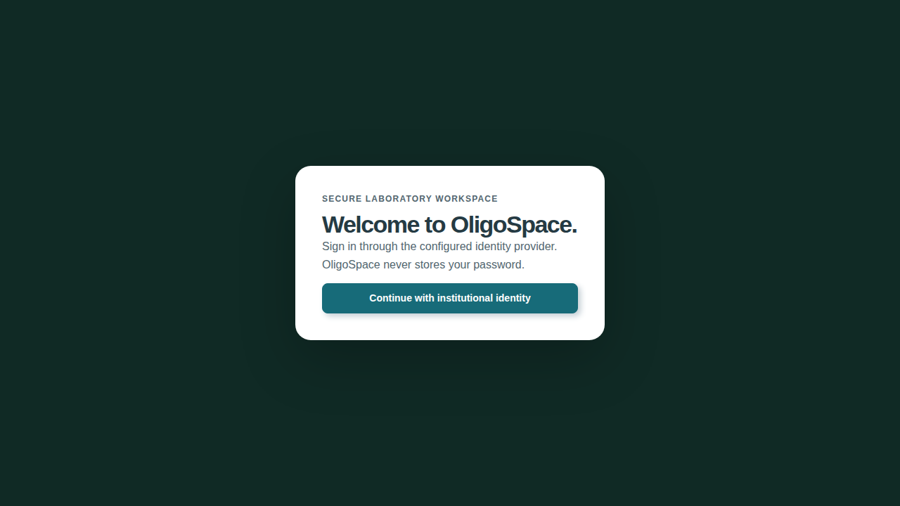
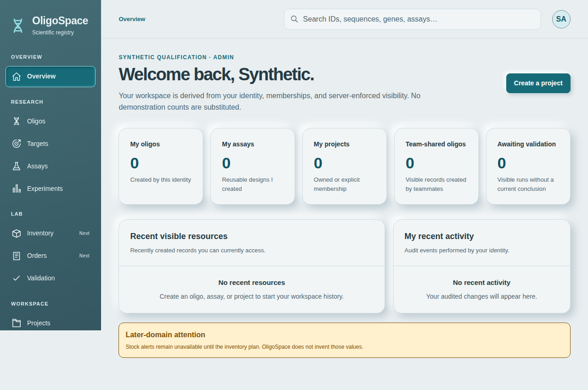
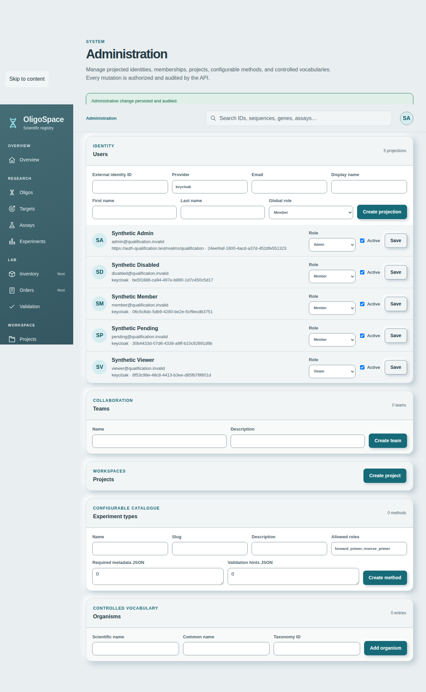

# MVP-01 — Authentication acceptance

Status: delivered for review (PR19, DRAFT, unmerged); real-OIDC qualification 16/16
passed at code SHA dc672aa (13/13 at 0c58d62 earlier); no pilot approval. Conditions for a private pilot are listed below.
Base main:5e10b750889275a0db76a94fdb1e85c83f95e88b (DEPLOY-02 merge).
One branch/PR only; no deployment, provider substitution or security waiver.

## Existing implementation and bounded plan

Keycloak Authorization Code+PKCE/state; NextAuth encrypted JWT session and refresh;
FastAPI RS256/issuer/audience/exp/iat/sub validation. Local provisioned user must
exist and be active; strongest allowed role is the lower of token/local roles.
Memberships are read from PostgreSQL on every API request. Admin UI/API already
create projections, enable/disable accounts and manage roles and memberships.
No self-registration or app-managed password. Keycloak reset-password is enabled
in the development realm, but no mail delivery/invitation qualification exists.
Preserve explicit subject provisioning; never associate by email automatically.

Demonstrated gaps to qualify/fix: JWT signature alone cannot observe Keycloak
logout/disable while a token is unexpired; logout currently removes browser session
and redirects without server-side invalidation; refresh failure retains old access
token. Add confidential-client introspection after cryptographic validation,
fail closed on unavailable/inactive provider, and bind local provider identity.
Keep JWT credentials server-side except existing access-token session contract;
never expose refresh tokens. Add provider logout via server-side NextAuth signOut
using its CSRF-protected endpoint. No schema/business policy rewrite.

## Execution and acceptance steps

- [x] Negative/positive API tests for crypto claims, provider active/revoked/down,
  local active/provisioning/provider binding, role and project permission changes.
- [x] Backend minimal fixes with bounded async introspection, production settings
  validation; frontend refresh/logout failure handling tests.
- [x] Isolated real Keycloak/PostgreSQL/Next.js/API Chromium fixture, AUTH_MODE=oidc,
  HTTPS, synthetic admin/member/viewer, PKCE/state, cookies, refresh, expiry,
  provider/local revocation, roles/direct API denial, logout and MFA.
- [x] Preserve unit/PostgreSQL/scientific and existing Chromium regressions;
  capture only synthetic safe screens, never cookies/tokens/raw HTTP traces.
- [x] Final matrix/results/limits, independent review, backlog and one PR.
  ResearchBrain/Basic Memory was not reachable from this session: not updated (see
  Remaining limitations).

## DEPLOY-02 integration boundary

Owner authorized integration only of7c81574, merged5e10b75. Residual Debian and
supplier findings remain visible and release-blocking; no acceptance for real use.
Reexamine2026-11-16 or earlier on fix/new risk. Priority security follow-up:
evaluate minimal/alternative Debian13 API/worker images preserving Python,
Primer3, BLAST and native ARM64/AMD64 reproducibility. Not implemented in MVP-01.

## Role and rights matrix

| Role | Identity/admin | Scientific resources | Membership management |
|---|---|---|---|
| admin | Provision explicit subjects, edit role/active; existing last-admin safeguards | Existing organization-scoped policies retained | Existing server-side policy |
| member (scientist) | Own profile; admin APIs denied | Create within permitted scope, read/edit according to owner/project/team policy | Project/team manager policy only; no global admin implied |
| viewer | Own profile; admin APIs denied | Read only within current visibility; mutation/compute denied | No privilege inferred from hidden controls |

team_manager remains an existing fourth scoped role, not removed by the three-role
acceptance fixture. Effective global role remains min(local role, OIDC role).
User active state and current team/project memberships are re-read on each API
call; cached frontend menus do not grant rights. Global admin is not cross-institute
access. Existing scientific visibility and permission tests are retained.

## Corrections and operational contract

1. Verify JWT locally before any introspection/identity lookup: RS256, signature,
   issuer, audience, expiration, iat and nonblank subject. Introspection must return
   boolean active=true; timeout/HTTP/provider/JSON failures deny access with safe401.
   Network timeout is5seconds; provider availability is now required per API call.
2. Bind stored provider to configured issuer. Existing literal keycloak mappings
   migrate to that issuer; a different stored provider is rejected before mutation.
   No email-based auto-linking, self-registration, invite, password storage or
   PostgreSQL schema migration was introduced.
3. Failed refresh removes usable access/refresh credentials and marks the session
   expired. A server-only logout credential remains in the encrypted NextAuth JWT
   so provider logout can be retried after a transient outage; it is never included
   in the browser session response. Browser access-token exposure is an existing
   contract preserved here, not a claim that bearer tokens are inaccessible to JS.
4. UserMenu first requests authenticated same-origin JSON POST provider logout.
   Failure retains the local session and shows a retry alert. Only confirmed logout
   proceeds to NextAuth's CSRF-protected signOut; the signOut event also attempts
   provider cleanup for direct NextAuth callers. Its warning contains a rule ID
   only. A direct NextAuth signOut alone is not provider-confirmation evidence.
5. Existing Compose configuration needed client credential forwarding to API and
   migration processes. The same existing outside-Git client ID/secret is wired;
   static policy now checks consistency/strength across API/migrate/web. No host,
   network, volume, image provider or deployed stack was changed.

### Configuration required before any pilot qualification

- API AUTH_MODE=oidc, OIDC_ISSUER canonical HTTPS, OIDC_AUDIENCE, OIDC_CLIENT_ID
  and OIDC_CLIENT_SECRET outside Git. Secret repr suppressed. Provider must allow
  confidential-client introspection and logout. No JWT-only fail-open fallback.
- Web AUTH_MODE=oidc, NEXTAUTH_URL canonical HTTPS, independent NEXTAUTH_SECRET,
  KEYCLOAK_ISSUER matching API issuer and matching confidential client credentials.
  PKCE S256/state/nonce and exact redirect URI; Secure/HttpOnly/Lax session cookies.
- Development realm file contains demo identities and is NOT an approved pilot
  import. Pilot must bootstrap institution-owned accounts and references explicitly,
  without demo users, default passwords or development authentication.
- Existing Keycloak reset-password feature requires mail delivery/operator policy
  qualification. No invitation/email delivery flow or Keycloak account creation
  UI exists in OligoSpace. Admin Create projection does not create a Keycloak user.
- Keycloak administration, MFA enrollment/recovery, issuer reachability/trust from
  browser and containers, secret rotation and outage/recovery remain operator gates.
  The fixture's synthetic TOTP flow is not institution-wide MFA-policy approval.

## Verification status and evidence attribution

Local API:99 passed,198 PostgreSQL cases skipped because no server was available
(local only; the PostgreSQL suites pass in CI, see below);
47 new signed-token/introspection/identity/role-revocation cases included.
API Ruff/configured strict mypy pass. Web14 tests, strict typecheck and scoped lint
pass using temporary official-checksum-verified Node22.23.0. Existing cached
prototype/.next output requires a local lint exclusion only; CI uses clean source.
Infrastructure90 tests and7 qualification guard tests pass; Compose configuration passes. Combined make
format/lint/typecheck/test cannot reach local Docker daemon. Local Turbopack build
also hit a process/port permission error; no local build pass is claimed.
CI is authoritative for Docker builds, PostgreSQL and real Chromium/science.

## Final checks before merge (code SHA dc672aa)

Three targeted checks were added without widening functional scope. Documentation
commits after `dc672aa` do not change code.

**Real-OIDC at dc672aa (run 41626472638): 16/16 passed.** Application CI passes:
backend, integration/PostgreSQL, migration, frontend, bioinfo-worker, compose,
deployment-contract and the scientific `chromium` job. Secret/token log gate passed.
Still red and unwaived: the DEPLOY-02 scan gates (security remediation regressions,
storage candidate image security, release image qualification, targeted review).

### AUTH-B1 — last active administrator (resolved)

Reproduced before the fix: two administrators demoting/deactivating each other
concurrently both succeeded (2 admins and a 3-admin cycle all `ok`), leaving no
active administrator. `update_user` now locks the organization's active admins
(`SELECT ... FOR UPDATE ORDER BY id`, `populate_existing`) when a change can reduce
their number, and refuses with 422 `last_active_administrator_required` if the target
would be the last one. `tests/integration/test_admin_concurrency.py` (5 cases, forced
transaction overlap) passed 3 consecutive runs. Residual: a demotion can be refused
while a concurrent promotion is not yet visible; this is a safe-direction false
refusal, retry succeeds.

### Cross-organization isolation

`tests/integration/test_cross_organization_isolation.py` (PostgreSQL) and a real-OIDC
journey with two Keycloak identities in different organizations (API read/list/CSV/
patch/put/delete/foreign keys in both directions, UI 404). A mutation test removing
the organization filter made the PostgreSQL test fail. Not covered: audit (only an
actor-filtered own-activity view exists), attachments, jobs/runs/validations in the
real-OIDC journey.

### Introspection cost and Keycloak outage (disposable local topology, not pilot sizing)

80 requests per phase, 0 errors; p50/p95/max in ms; requests per second.

| Concurrency | `/health/live` | `/me` (JWT + JWKS fetch + introspection + DB) | direct Keycloak introspection |
|---|---|---|---|
| 1 | 2.9/3.9/12; 310 | 20.6/23.5/26.6; 47.7 | 4.2/6.1/8.4; 227 |
| 4 | 8.4/12/19.5; 437 | 56.5/70.9/89.8; 68.1 | 9.8/14.9/18; 376 |
| 8 | 14.7/19.8/31.8; 509 | 110.4/247.2/343.7; 63.6 | 19.6/22.1/25.8; 413 |
| 16 | 27.1/54.6/59; 519 | 298.1/669.6/792.8; 42.7 | 32.5/40.9/43.2; 473 |

`/me` saturates near 43-68 rps because each call does a JWKS fetch, an introspection
and a DB read; the direct introspection column is measured separately. No security
cache was introduced; immediate revocation and fail-closed are unchanged.

Outage: with Keycloak stopped, a still-unexpired token got 401 on all 26 requests
(10 sequential, 16 concurrent; p50 7.9 ms, max 10.6 ms), `/health/live` stayed 200,
the UI showed "Session required", and a fresh login worked after restart (about
18.7 s to recover). Caveats stated plainly: (1) these refusals came from
`JWKS_FETCH_FAILED` (29), not introspection (introspection failure counters 0):
`_decode_token` builds a new `PyJWKClient` per request, so there is no JWKS cache and
every call fetches JWKS. Fail-closed holds, but the actual denial path is the JWKS
fetch. Whether to reuse/cache JWKS is an owner decision (AUTH-B6); not changed.
(2) `recovery_old_token_status = 401` is an expired 90 s token, not revocation proof.

### Pre-existing dependency defect found and fixed

The `chromium` job failed at `cd77bf0` on three Primer3 journeys ("job saved but could
not be dispatched"). Cause: `kombu 5.7.0` (published 2026-11-03) needs `packaging`
only through `kombu[redis]`, which `celery[redis]==5.4.0` does not request, so
`send_task` raised `ModuleNotFoundError`. Reproduced locally. Not an MVP-01 change;
`kombu==5.6.2` is now pinned in `envs/api.yml`, `envs/bioinfo.yml` and both
`pyproject.toml` files. Other transitive Celery dependencies remain unpinned.

### Second independent review (read-only) dispositions

- "Concurrent promotion bypass" rated major: judged a safe-direction false refusal, not an invariant break (see AUTH-B1).
- JWKS per request: confirmed, recorded as AUTH-B6.
- Outage denial path via JWKS: confirmed, documented above.
- Audit cross-organization untested: documented above.
- Client secret passed to the browser container: harness only, disposable; accepted.
- kombu pin consistent across the four files.

Cases 14-16 of the real-OIDC suite: cross-organization isolation, introspection
measurement under light concurrency, and Keycloak outage fail-closed/recovery.
Evidence: [introspection-load.json](evidence/introspection-load.json),
[keycloak-outage.json](evidence/keycloak-outage.json); no token or secret matched a
grep on the evidence files.

## Results at head 0c58d62 (earlier, 13 journeys)

Real-OIDC qualification (run 41549959570, disposable HTTPS Keycloak 26.7.2, PostgreSQL,
production Next.js and API, Chromium, AUTH_MODE=oidc): **13/13 passed**, artifacts in
[evidence/](evidence/summary.json). Application CI (runs 41549959456 and 41549952778)
passes: backend, integration (PostgreSQL), migration, bioinfo-worker, frontend,
compose, deployment-contract, and the existing scientific/functional Chromium job
(`chromium`, run 41549959418). Secret/token log gate: passed for api, web, keycloak, caddy
([secret-log-gate.json](evidence/secret-log-gate.json)). API rule counters for the
run: introspection inactive 4 (expected revocations), JWT claims invalid 1 (the
bogus-token journey), signature/JWKS/transport/HTTP/JSON failures 0.

Red checks on the PR are exclusively DEPLOY-02 vulnerability/supplier gates
(baseline-secret-triage, native-image api/worker, seaweedfs, garage). They fail by
scan exit code 2 on documented findings, do not touch authentication, are not waived
and remain release-blocking. They do not run on `main`.

| # | Journey (real provider) | Result |
|---|---|---|
| 1 | Login with PKCE S256, state, nonce; Secure/HttpOnly/Lax cookies | passed |
| 2 | Callback with forged state yields no session | passed |
| 3 | Unprovisioned identity gets 403 + recovery screen; admin provisions; login then works | passed |
| 4 | Member: admin APIs 403 (read and write), /admin denied | passed |
| 5 | Viewer: admin APIs 403, project creation 403, /admin denied | passed |
| 6 | Anonymous, malformed and development-header requests 401 | passed |
| 7 | Wrong password creates no session | passed |
| 8 | Project grant then revoke apply to the same issued token (200 then 404) | passed |
| 9 | Local deactivation: already-issued valid token gets 403; recovery screen; logout | passed |
| 10 | Provider logout failure keeps session and shows retry; confirmed retry revokes token (401) and SSO | passed |
| 11 | Access token refresh; logout ends provider SSO | passed |
| 12 | Keycloak account disabled: issued token 401, refresh fails, session marked expired | passed |
| 13 | TOTP enrollment then MFA challenge, invalid then valid code | passed |

Login/logout/refresh/revocation flow: login = Authorization Code + PKCE through
Keycloak; API verifies JWT then introspects per call; refresh by NextAuth server side
(a failed refresh drops usable credentials); logout = same-origin CSRF-checked POST
to the provider-logout route, then NextAuth signOut only after provider confirmation;
revocation = provider disable (introspection inactive) or local `active=false`
(403) or membership removal (404), all effective on tokens already issued.

A first qualification run at 22ba4c9 passed 11/13; the two failures (journeys 3 and 9)
were a test race, not a product defect: after "Manage session" the page is already on
`/login`, so the URL assertion passed before logout finished and the session was read
too early. The test now polls until the session is ended, and also proves provider SSO
ended by requiring the Keycloak password form on the next login. No product code
changed for that fix; the failing result is retained here, not hidden.

### Screens (synthetic data only, no cookies/tokens/URLs with codes)

The administration capture shows the issuer URL stored for the identity that already
logged in, versus the literal `keycloak` for projections not yet bound; the latter is
migrated to the configured issuer at first successful login.

## Independent review (read-only, separate agent, final head)

Confirmed: RS256-only with signature/issuer/audience/exp/iat/sub checks, fail-closed
introspection with 5 s timeout, development headers ignored under oidc, production
settings validation, subject-keyed identity without email linking, per-request active
and role re-read, organization-scoped access checks, logout origin/content-type check,
no refresh token in the browser session, no secrets in repository or logs gate.

Findings and disposition:
- Reported as major: "last admin can be disabled". Verified partly incorrect at that
  time: a single actor cannot demote themself, but concurrent mutual demotion by two
  administrators was not serialized. Later reproduced and fixed (see AUTH-B1 above).
- Minor: legacy `keycloak` provider literal is accepted and rebound to the issuer.
  Intentional, documented migration; a different issuer is rejected. Backlog AUTH-B2
  to retire the literal after pilot bootstrap.
- Minor: email/display name are refreshed from validated claims on each request.
  Accepted: claims come from a signature- and introspection-verified token; no
  authorization decision uses them. Backlog AUTH-B3 (audit on change).
- Not covered by tests (stated, not claimed): concurrent logout/refresh race,
  multi-tab refresh-token rotation, issuer change scenario. The cross-organization
  real-OIDC journey is now covered (see above).

Independent review found the credential-wiring and logout-failure regressions
(earlier pass); fixes and negative tests were added in the same PR. Final
re-review: see section above.

## Remaining limitations and private-pilot decision

Missing or out-of-scope features (explicit, none added in this PR): invitation by
email, account creation in Keycloak from OligoSpace, self-registration, password
reset qualification (Keycloak feature exists, mail delivery unqualified), MFA
recovery policy, institutional SSO/federation, session listing/forced remote logout
for all of a user's sessions from the OligoSpace UI. Proposing any of these is a
separate product decision awaiting the owner.

Conditions for a private pilot (all must hold, none is granted by this PR):
1. Owner decision on this PR and on the open DEPLOY-02 release gates (reexamine
   2026-11-16 or earlier).
2. Institution-owned Keycloak realm bootstrapped without demo identities, default
   passwords or `AUTH_MODE=development`; confidential client secret rotated and held
   outside Git; HTTPS issuer reachable and trusted by browser and containers.
3. Operator procedure for MFA enrollment/recovery, reset-password mail delivery,
   Keycloak outage (API fails closed) and account offboarding (disable in Keycloak and
   local projection).
4. Re-run of the real-OIDC qualification against the pilot topology (all 16 cases),
   before any real use.
5. Backlog items AUTH-B2..B6 reviewed (AUTH-B1 resolved), including the owner decision
   on JWKS reuse/caching.

ResearchBrain/Basic Memory was not available in this session (no tool exposed), so
no memory note was written; the owner should record the outcome from this dossier.

MVP-01 is not a deployment approval. Retain DEPLOY-02 security findings and all
release gates. No claim of validated real host, institutional SSO/federation,
mail delivery, MFA recovery, HA/Keycloak outage availability, or multiple concurrent
tab refresh-token rotation. Provider unavailable means fail closed, not continued
access. Review successful real-OIDC proofs and remaining security gates before any
private-pilot authorization. PR19 stays unmerged for user review.

## Diagnosed real-provider failures (not waived)

The initial real-provider run was not a success: valid-shaped tokens were rejected
with401. Controller0840521 preflight retained all expected structural booleans,
three OIDC_INTROSPECTION_INACTIVE events and zero JWT/JWKS/transport failures.
Keycloak26.7.2 [verifyAudience source](https://github.com/keycloak/keycloak/blob/26.7.2/services/src/main/java/org/keycloak/protocol/oidc/AccessTokenIntrospectionProvider.java#L273)
requires the authenticated introspection client to be an access-token audience.
The existing configuration minted oligospace-api audience only but authenticated
introspection as oligospace-web. An explicit second audience mapper for the
existing web client corrects this contract. API audience remains oligospace-api;
no issuer, signature, audience check or introspection enforcement is disabled.
The API and web are the two components of the same existing confidential-client
integration; a separately credentialed resource-server client would be a future
institutional design choice, not silently introduced here.

The original forged-state test also failed to intercept its intended redirect
(interception_seen=false); it did not demonstrate a bypass. The corrected test
alters Keycloak's actual form-response redirect and requires interception plus
absence of an application session. No state/code/URL is retained.
A failed login preflight now labels the other12 journeys not_executed and fails;
all13 must pass in a complete run. Log verification reads bounded service output
in RAM only; actual matches fail, incomplete/truncated reads are not_verified.
